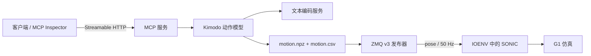

# Kimodo SONIC MCP

通过 MCP 将文本动作生成接入 SONIC：调用 Kimodo 生成 SMPL-X 动作，导出 NPZ 与同步 CSV，再通过 ZeroMQ Protocol v3 向 SONIC 发布动作数据。

**SONIC 仿真与部署环境使用 [IOENV / ioai-tech](https://github.com/ioai-tech/ioenv_cli) 提供的环境与镜像。** SONIC 控制器来自 [NVIDIA GR00T-WholeBodyControl](https://github.com/NVlabs/GR00T-WholeBodyControl)，动作生成模型来自 [NVIDIA Kimodo](https://github.com/nv-tlabs/kimodo)。本项目提供连接这些组件的 MCP 服务、导出适配和推流工具，第三方模型与控制器保留各自的来源和许可。

## 工作流程



- 生成、任务查询、推流启动与停止，通过 MCP 工具调用。
- 动作源默认 30 Hz；发布器重采样为 50 Hz，topic 为 `pose`。
- 生成在工作线程中执行，其他 MCP 请求仍可响应；同一时刻只允许一个生成任务和一个推流进程。
- 生成工具等待动作生成完成后返回结果。首次模型加载较慢时，应增加客户端超时，通过另一连接查询任务。

## 代码与第三方组件

| 组件 | 来源 | 在本项目中的作用 |
| --- | --- | --- |
| MCP 服务、任务管理、导出适配、ZMQ 发布器 | 本项目集成代码 | 将文本生成结果接入 SONIC |
| Kimodo | [nv-tlabs/kimodo](https://github.com/nv-tlabs/kimodo) | 文本编码调用、动作生成与 AMASS 导出 |
| SONIC / GR00T-WholeBodyControl | [NVlabs/GR00T-WholeBodyControl](https://github.com/NVlabs/GR00T-WholeBodyControl) | 全身控制、仿真与部署 |
| IOENV | [ioai-tech/ioenv_cli](https://github.com/ioai-tech/ioenv_cli) | 启动 SONIC 容器；当前验证镜像为 `ioaitech/sonic_sim:1.0` |

版本记录与许可来源见 [THIRD_PARTY_NOTICES.md](THIRD_PARTY_NOTICES.md)。仓库不包含上述项目的完整源码、模型权重或容器镜像。

## 目录

```text
sonic-mcp/
├── README.md
├── THIRD_PARTY_NOTICES.md
├── .env.example                     # 配置模板
├── requirements.txt                 # MCP / 推流依赖
├── requirements-validated.txt       # 当前验证过的依赖版本
├── run_kimodo_sonic_mcp.py           # 服务入口
├── call_kimodo_sonic_mcp.py          # 命令行客户端
├── publish_g1_smpl_data.py           # SMPL / Protocol v3 发布器
├── publish_g1_joint_data.py          # 完整 G1 CSV / Protocol v1 发布器
├── kimodo_sonic_service/            # 配置、模型封装、任务与进程管理
├── docker/                          # 独立项目的部署配置
├── docs/                            # 部署、协议、排障、发布说明
├── scripts/package_release.py       # 按白名单打包
├── tests/                           # 回归测试与可选远程生成检查
└── runtime/                         # 本机生成结果；不进入 Git 和发布包
```

## 启动

运行端需要 Linux、NVIDIA GPU、Docker Compose、NVIDIA Container Toolkit，以及已按 [Kimodo 官方说明](https://github.com/nv-tlabs/kimodo) 准备好的模型与文本编码依赖。仅运行单元测试不需要模型或 GPU。

```bash
cp .env.example .env
# 编辑 .env：填写外部 Kimodo 源码目录 KIMODO_SOURCE，以及有效的 CPU 范围。
mkdir -p runtime/kimodo_outputs

# 先构建 Kimodo 基础镜像，再构建 MCP 镜像。
docker compose --env-file .env -f docker/compose.yaml build text-encoder
docker compose --env-file .env -f docker/compose.yaml build kimodo-mcp
docker compose --env-file .env -f docker/compose.yaml up -d
```

这些命令用于新的独立部署。已有服务正在占用 8000、9550、5556 时，先阅读 [部署说明](docs/deployment.md)，完成端口或迁移安排。

MCP 地址：`http://<服务器IP>:8000/mcp`。在 MCP Inspector 中选择 Streamable HTTP，连接后先调用工具 `initialize`。

客户端可以安装本项目依赖后检查服务或生成动作：

```bash
python3 -m pip install -r requirements.txt
python3 call_kimodo_sonic_mcp.py --url http://<服务器IP>:8000/mcp health
python3 call_kimodo_sonic_mcp.py --url http://<服务器IP>:8000/mcp \
  generate "a person walks and waves" --duration 5 --steps 100
```

在 IOENV 中启动 SONIC 仿真、控制程序，再用生成结果的 `job_id` 启动推流，步骤见 [IOENV 接入说明](docs/ioenv-sonic.md)。

## 数据边界

`motion.npz` 保存 SMPL-X / AMASS 数据与 `[T,22,3,3] local_rot_mats`。`motion.csv` 是 36 列的 **v3 同步伴随文件**，其中 29 个机器人关节位置为零，不能直接作为完整 G1 关节轨迹用于 v1 播放。默认 v3 推流从 NPZ 获取人体动作，并从 SMPL 计算腕关节。

`publish_g1_joint_data.py` 需要另行提供完整 G1 重定向 CSV。当前项目没有实现 SMPL-X 到 G1 全部关节的重定向，也不训练 Kimodo 或 SONIC 模型。发布器针对当前验证版本的 v3 接口；切换第三方镜像或控制器版本后，应重新检查协议兼容性。

## 测试与打包

```bash
python3 -m pip install -r requirements-validated.txt
python3 -m unittest discover -s tests -v
python3 scripts/package_release.py --output dist/sonic-mcp.zip
```

单元测试使用模拟模型与临时目录，不启动真实推流。打包脚本只收录源码、测试、配置模板和文档，排除模型、缓存、真实配置、任务数据和备份。发布步骤见 [发布说明](docs/publishing.md)。

## 文档

- [部署与配置](docs/deployment.md)
- [SONIC / IOENV 接入](docs/ioenv-sonic.md)
- [MCP 工具与使用](docs/mcp-tools.md)
- [故障排查](docs/troubleshooting.md)
- [ZMQ 协议](docs/groot_zmq_stream_protocol.md) · [v3 发布器实现](docs/groot_zmq_v3_publisher_implementation.md)
- [非阻塞生成修正与历史验证](docs/kimodo_mcp_nonblocking_fix.md)
- [打包与 GitHub 展示](docs/publishing.md)
